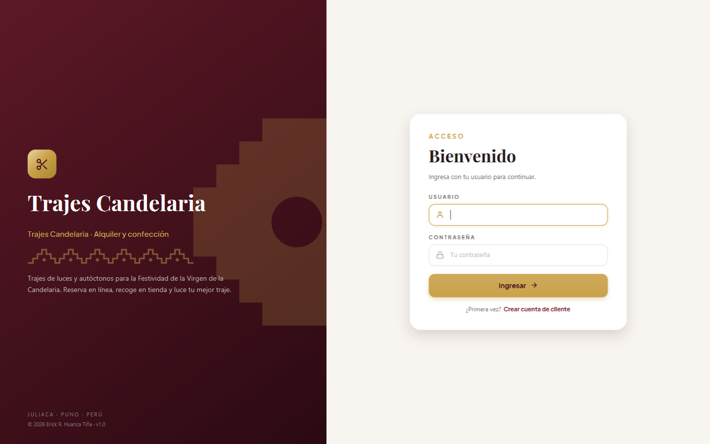
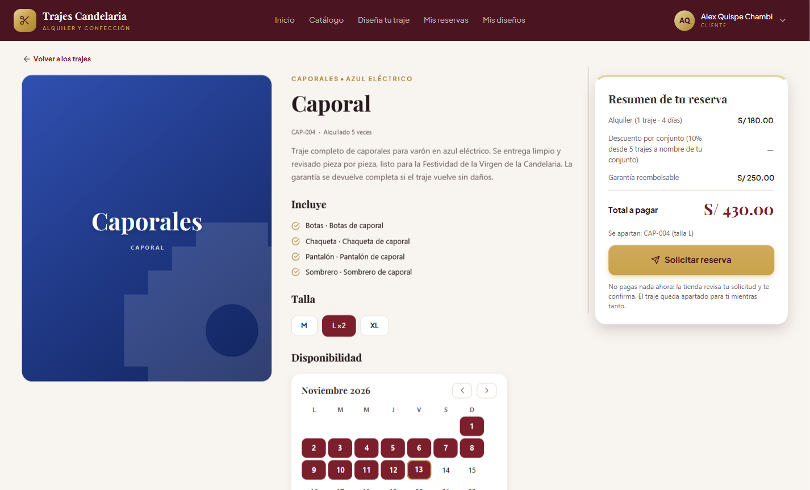
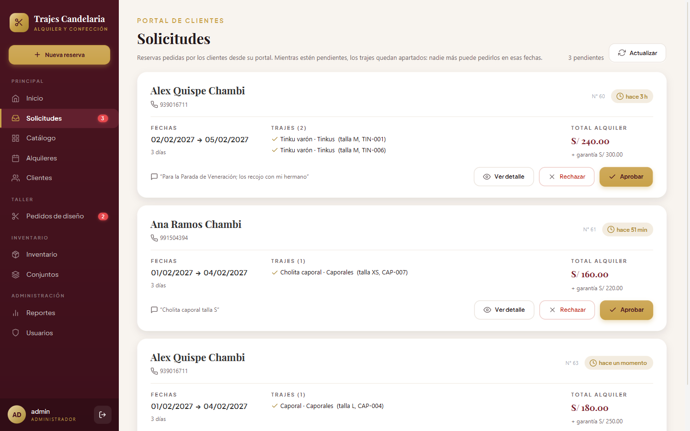

# Trajes Candelaria

Sistema de escritorio para el **alquiler y la personalización de trajes de danza**, pensado para una tienda de
Juliaca que viste a los conjuntos de la **Festividad de la Virgen de la Candelaria (Puno)**: diablada, morenada,
caporales, tinkus, kullawada y más.

Tiene dos caras: un **portal para el cliente**, donde ve los trajes libres en tiempo real, solicita reservas y
diseña su propio traje; y un **panel para la tienda**, donde se aprueban las solicitudes, se gestionan alquileres,
entregas, devoluciones con daños, pagos y la confección de trajes a medida. Las reglas del negocio (que un traje no
se alquile dos veces en las mismas fechas, los montos, los estados) las garantiza la propia base de datos con
restricciones, triggers y funciones.

| Inicio de sesión | Portal del cliente | Panel de la tienda |
|---|---|---|
|  |  |  |

## Funcionalidades

### Portal del Cliente
- **Inicio y catálogo**: buscador por danza y fechas (usa `fn_trajes_disponibles`), tarjetas con estado
  (“Listo hoy en tienda”, “Disponible desde dd/MM”), “Más alquilado”, piezas, tallas y garantía.
- **Detalle del traje**: fotos, piezas incluidas, tallas, mini calendario con los días ocupados, cantidad para
  conjuntos (10% de descuento desde 5 trajes) y resumen con garantía reembolsable.
- **Solicitar reserva**: crea el alquiler en estado *SOLICITADO*; el traje queda apartado para que otro cliente no lo
  pida en las mismas fechas.
- **Diseña tu traje**: personalizador por capas sobre renders de Blender. Danza, prenda, color (paleta o libre),
  implementos y modalidad (confeccionar o alquilar), con precio estimado al instante.
- **Mis reservas**: línea de tiempo Solicitado → Reservado → Entregado → Devuelto, con el motivo si fue rechazada.
- **Mis diseños**: estado del pedido, precio estimado y precio final cotizado, para aprobarlo o rechazarlo.
- **Perfil**: datos de contacto y cambio de contraseña.

### Panel del Vendedor
- **Inicio**: indicadores (solicitudes pendientes, trajes disponibles, alquileres activos, devoluciones del día,
  ingresos del mes) y agenda de próximos movimientos.
- **Solicitudes** (con insignia de pendientes): aprobar o rechazar con motivo, con la antigüedad de cada pedido.
- **Alquileres**: nueva reserva, pagos, entrega, devolución con registro de daños por pieza y cálculo de la garantía.
- **Pedidos de diseño** (con insignia): cotizar, iniciar confección, marcar listo y entregar.
- **Clientes, inventario de trajes y conjuntos**.
- **Reportes** y **Usuarios** (solo el administrador).

## Tecnologías

- **Java 17+** y **JavaFX 21** (interfaz de escritorio, fuentes Playfair Display y Plus Jakarta Sans, íconos Ikonli)
- **Spring Boot 3.5** (solo JDBC y transacciones, sin servidor web) · contraseñas con **BCrypt**
- **PostgreSQL** (restricciones, triggers, funciones y vistas)
- **Blender** (renders por capas para el personalizador)
- **Maven** (incluye `mvnw`, no hace falta instalarlo)

## Requisitos

- JDK 17 o superior (recomendado 21)
- PostgreSQL 13 o superior
- IntelliJ IDEA (opcional, recomendado)

## Instalación

1. **Clonar el repositorio**

   ```bash
   git clone https://github.com/Erickr55-r/trajes-candelaria.git
   cd trajes-candelaria
   ```

2. **Crear la base de datos**

   ```sql
   CREATE DATABASE alquiler_trajes;
   ```

3. **Ejecutar los scripts SQL en este orden** (crean las tablas, triggers, funciones, vistas y los datos de ejemplo)

   ```bash
   psql -U postgres -d alquiler_trajes -f src/main/resources/db/base_datos.sql
   psql -U postgres -d alquiler_trajes -f src/main/resources/db/personalizador.sql
   ```

   > Si ya tenías una base creada con una versión anterior, no hace falta borrarla: aplica las migraciones
   > `login_roles.sql`, `portal_cliente.sql`, `panel_vendedor.sql` y `diseno_capas.sql` (en ese orden).

4. **Configurar la contraseña de PostgreSQL** como variable de entorno (no se escribe en el código; ver
   `src/main/resources/application-example.properties`):

   - IntelliJ: *Run → Edit Configurations → Environment variables* → `DB_PASSWORD=tu_password_aqui`
   - Windows (terminal): `setx DB_PASSWORD "tu_password_aqui"` y abrir una terminal nueva
   - Linux / macOS: `export DB_PASSWORD=tu_password_aqui`

   Opcionales: `DB_USER` (por defecto `postgres`) y `DB_URL` (por defecto `jdbc:postgresql://localhost:5432/alquiler_trajes`).

5. **Ejecutar**

   - IntelliJ: abrir `src/main/java/com/trajes/Launcher.java` y pulsar ▶ (ejecuta siempre `Launcher`, no `AppFx`).
   - Terminal: `./mvnw javafx:run` (en Windows: `mvnw javafx:run`).

## Usuarios de prueba

| Usuario    | Contraseña   | Rol      | Qué ve                                               |
|------------|--------------|----------|------------------------------------------------------|
| `admin`    | `admin123`   | ADMIN    | Panel de la tienda completo, con Reportes y Usuarios |
| `vendedor` | `venta123`   | VENDEDOR | Panel de la tienda sin Reportes ni Usuarios          |
| `cliente`  | `cliente123` | CLIENTE  | Portal del cliente                                   |

También se puede crear una cuenta de cliente desde la pantalla de inicio de sesión.
Son cuentas de demostración que crean los scripts SQL; cámbialas antes de usar el sistema de verdad.

## Estructura de carpetas

```
trajes-candelaria/
├── pom.xml, mvnw, mvnw.cmd, .mvn/        Maven
├── capturas/                             capturas de pantalla
├── LEEME.md                              guía detallada (flujos, reglas de la base de datos, problemas comunes)
└── src/main/
    ├── java/com/trajes/
    │   ├── Launcher.java                 punto de entrada
    │   ├── modelo/                       records con los datos de cada pantalla
    │   ├── servicio/                     SQL con JdbcTemplate y @Transactional
    │   └── fx/
    │       ├── LoginView, PortalClienteView, PanelVendedorView, Sesion, Ui, ...
    │       ├── portal/                   pantallas del portal del cliente
    │       ├── vistas/                   pantallas del panel de la tienda
    │       ├── foto/                     personalizador por capas (teñido de los renders)
    │       └── legacy/                   personalizador 3D anterior (ya no se usa)
    └── resources/
        ├── application.properties        conexión (lee DB_PASSWORD de una variable de entorno)
        ├── application-example.properties
        ├── estilos.css, tema-guindo.css, tema-marino.css
        ├── fonts/                        Playfair Display y Plus Jakarta Sans (licencia OFL)
        ├── render/<danza>/<ángulo>/      renders por capas (base.png + un PNG por prenda)
        └── db/                           scripts SQL y migraciones
```

## Autor

**Erick Reison Huanca Tiña** – Ingeniería de Software y Sistemas, Universidad Nacional de Juliaca (UNAJ) –
curso Base de Datos.
